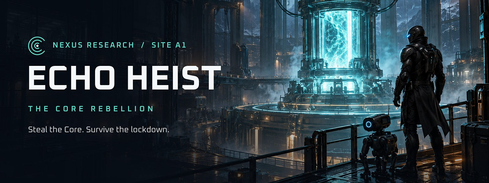
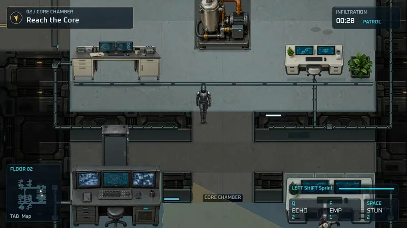
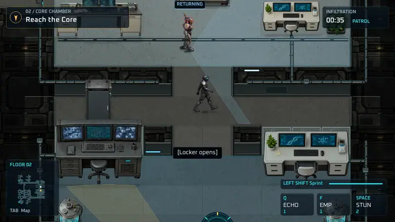
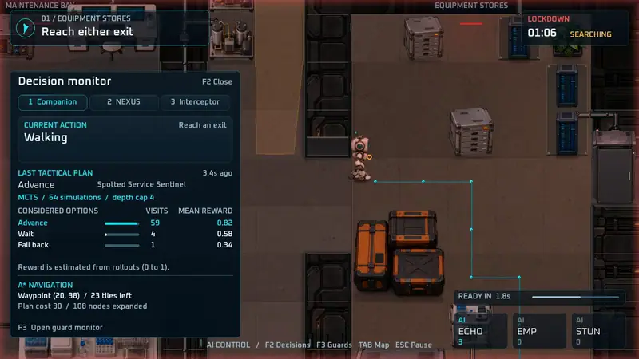
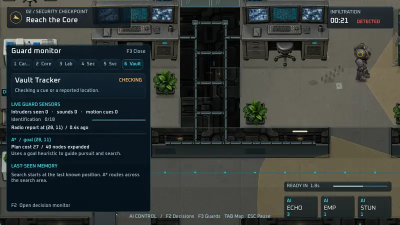
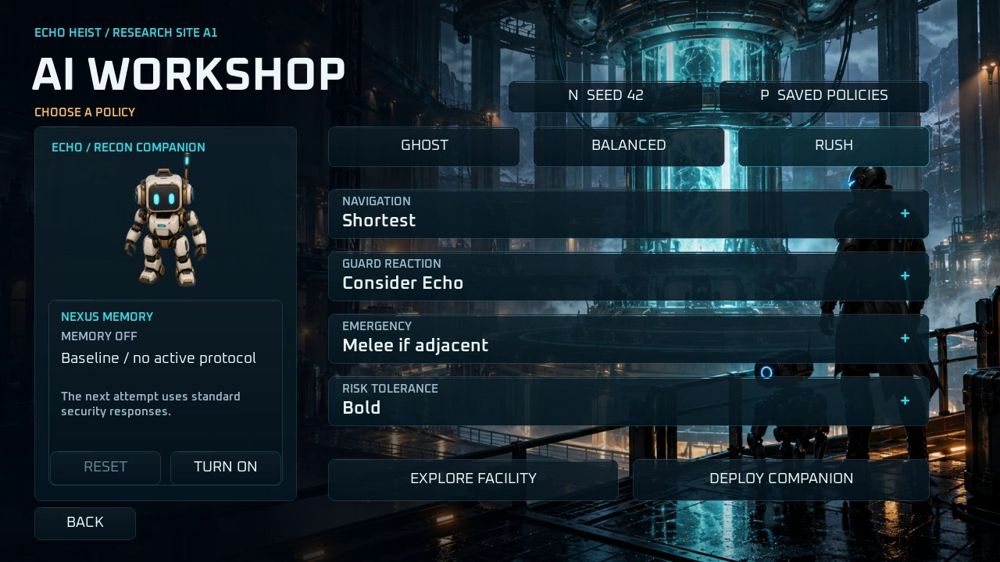

<p align="center">
  
</p>

<h3 align="center">A top-down stealth heist where every guard thinks for itself, and so can the thief.</h3>

<p align="center">
  <a href="https://github.com/khalid999devs/Echo_Heist/releases/latest"></a>
  
  
  
  <a href="https://github.com/khalid999devs/Echo_Heist/actions/workflows/checks.yml"></a>
  <a href="LICENSE.md"></a>
</p>

<p align="center">
  <a href="#download">Download</a> &nbsp;·&nbsp;
  <a href="#how-to-play">How to play</a> &nbsp;·&nbsp;
  <a href="#the-ai-behind-each-character">The AI</a> &nbsp;·&nbsp;
  <a href="#run-from-source">Run from source</a> &nbsp;·&nbsp;
  <a href="docs/submission/Echo_Heist_Final_Project_Report.pdf">Project report</a>
</p>

## About the game

NEXUS, a rogue AI, has sealed off a research building and keeps an experimental energy Core at its centre. You slip in, take the Core and get out through one of two airlocks before the security team catches you.

None of the guards follow a script. Each type sees, listens, remembers and plans in its own way, built on a different classic AI technique, and NEXUS reads what the guards report and decides where to send them. You can play the thief yourself, or hand the mission to a robot Companion that plans the whole heist alone while you watch its reasoning on screen.

ECHO HEIST started as our final project for the Artificial Intelligence Laboratory course (CSE 3210) at KUET. It runs natively on Windows and macOS.

## Why play it

- **Guards with different minds.** Sentinels patrol and use fuzzy logic to decide how worried a noise should make them. Trackers hunt you with A* to the last place they saw you. Interceptors work out which gate you will run for and get there first. Learning to beat one kind does not teach you how to beat the others.
- **Stealth with real choices.** Step into a locker, crawl under a desk, throw a hologram that replays your last few steps, stun a guard that grabs you, or switch off every guard nearby with an EMP. Gadget charges never come back, so each one matters.
- **A heist in two halves.** The building stays calm until you lift the Core. Then the alarm sounds, the lights turn red, every guard speeds up and the quiet infiltration becomes an escape.
- **A robot that plays without you.** Pick a personality in the AI Workshop and the Companion runs the mission by itself, planning with Monte Carlo tree search. Press F2 to see the options it weighed and why it chose one.
- **AI you can watch, and AI that plays fair.** Press F3 to see each guard's mood, senses and planned path. No character cheats. Every AI acts only on what it could actually see or hear.
- **A building that learns.** Turn on NEXUS memory and a trick that works twice gets answered on the next attempt, for example by checking decoys more carefully or guarding the route you keep using.
- **Runs you can replay.** Every mission comes from a seed, so you can retry the exact same situation or press N for a new one. Escapes are scored out of 100, ranked from S to F and saved to your history.

## See it in action

<table>
  <tr>
    <td width="50%"></td>
    <td width="50%"></td>
  </tr>
  <tr>
    <td align="center"><sub>A hologram decoy pulls the Vault Tracker away</sub></td>
    <td align="center"><sub>Taking the Core sets off the lockdown</sub></td>
  </tr>
  <tr>
    <td width="50%"></td>
    <td width="50%"></td>
  </tr>
  <tr>
    <td align="center"><sub>The Companion plays alone, and F2 shows the moves it considered</sub></td>
    <td align="center"><sub>F3 shows a Vault Tracker's live A* plan</sub></td>
  </tr>
</table>

<p align="center"><sub>All clips are real gameplay at normal speed.</sub></p>

## Two ways to play

**Human against AI.** You control the thief with the keyboard and try to outwit six guards and the building itself.

**AI against AI.** Open the AI Workshop, choose the Ghost, Balanced or Rush preset or set the four behaviours yourself (how the robot moves, how it reacts to guards, what it does in an emergency and how much risk it accepts), then deploy the Companion and watch it play.

<p align="center">
  
</p>

## Download

The latest builds are on the [Releases page](https://github.com/khalid999devs/Echo_Heist/releases/latest). Python is not needed to play them.

| Platform | File | First run |
| --- | --- | --- |
| Windows, 64-bit | [echo-heist-0.1.0a2-windows-x64.zip](https://github.com/khalid999devs/Echo_Heist/releases/download/v0.1.0a2/echo-heist-0.1.0a2-windows-x64.zip) | Extract the whole zip, keep the `EchoHeist` folder together and open `EchoHeist.exe` |
| macOS, Apple Silicon | [echo-heist-0.1.0a2-macos-arm64.zip](https://github.com/khalid999devs/Echo_Heist/releases/download/v0.1.0a2/echo-heist-0.1.0a2-macos-arm64.zip) | Extract the zip and open `Echo Heist.app` |

The builds are not signed by Microsoft or Apple yet, so each system asks once before the first launch.

- **Windows.** If SmartScreen says "Windows protected your PC", click **More info** and then **Run anyway**.
- **macOS.** If macOS says it cannot check the app, open **System Settings**, go to **Privacy & Security** and click **Open Anyway** next to Echo Heist. You can also run `xattr -dr com.apple.quarantine "Echo Heist.app"` in Terminal from the folder that holds the app.

Intel Macs and Linux are not packaged yet. Both can [run the game from source](#run-from-source).

## How to play

Every mission has four steps.

1. **Sneak in.** Cross two floors without being recognised.
2. **Take the Core.** Hold E beside it for under a second. The alarm goes off.
3. **Survive the lockdown.** Every guard speeds up and starts hunting you.
4. **Escape.** Leave through the Entry airlock or the Cargo airlock with the Core.

Guards see in a cone and need a moment of steady looking before they are sure it is you, so breaking line of sight early often saves a run. A guard that reaches you starts a grab, and if it lasts 0.4 seconds the mission is over. A stun or an EMP breaks it.

| Key | Action |
| --- | --- |
| WASD or arrow keys | Move |
| Left Shift | Sprint for up to 3 seconds, with louder footsteps |
| C | Crouch, and slip under desks |
| E | Use stairs, doors and lockers, or hold beside the Core to take it |
| Q | Echo decoy, a hologram that replays your last 2.5 seconds (3 charges) |
| F | EMP, switches off nearby guards for 3 seconds (1 charge) |
| Space | Stun the guard next to you (2 charges) |
| Tab | Facility map |
| F2 and F3 | Companion decision monitor and guard monitor |
| Esc | Pause |

Every key can be remapped in Settings, which also has sound captions, a high-contrast HUD, reduced flashing and fullscreen.

An escape earns 50 points, up to 40 more for stealth (minus 12 each time a guard confirms it saw you) and 10 for finishing within 15 minutes. A total of 90 or more earns an S, 75 or more an A and 60 or more a B. Anything lower is a C, and getting caught is an F.

## The AI behind each character

| Character | Role in the game | How it decides |
| --- | --- | --- |
| **2 Sentinels** | Patrol, listen and check out noises | A finite-state machine with six moods, BFS for paths and fuzzy logic to rate how urgent a clue is |
| **2 Trackers** | Hunt you down to where they last saw you | A* search with an estimate that understands staircases, plus a short last-seen memory |
| **2 Interceptors** | Predict your escape and block a gate | Minimax with alpha-beta pruning over the routes you are likely to take |
| **NEXUS** | The building's brain, with no body | Turns guard reports into jobs, scores them by priority and assigns the best guard to each, with optional memory between missions |
| **Companion** | The robot thief that plays the heist alone | A mission state machine, utility scores for emergencies, Monte Carlo tree search for tactics and A* that avoids known danger |

**Fair play is built into the architecture.** Each character receives a filtered, read-only observation of what it can perceive and returns an action. Only the simulation changes the world, so no AI can read the player's true position or peek at another character's plan.

The guards are strong on purpose. In a wide test of 1,200 robot missions over seeds 1 to 400, the robots stole the Core 168 times, but only the Rush personality got out, three times. Balanced and Ghost reach the Core and are caught on the way out. The [project report](docs/submission/Echo_Heist_Final_Project_Report.pdf) explains every algorithm with worked examples and traces one real decision step by step through minimax and MCTS.

## Engineering highlights

- **Simulation first.** The rules live in a pure Python core that never imports pygame. Rendering, input and sound form a separate layer on top, so the whole game can run headless for tests and experiments.
- **Deterministic and seeded.** The same seed and the same inputs always produce the same mission, which keeps bugs reproducible and AI comparisons fair.
- **One controller interface.** The human, the Companion and every guard plug in the same way, observation in and action out, so swapping a person for an AI changes nothing else.
- **Fast enough to think.** Most game ticks take under 1.7 milliseconds, well inside the 33 milliseconds available at 30 ticks per second, even with searches running.
- **Tested and typed.** 359 automated tests, strict mypy, ruff and a structure check that keeps every source file under 1,000 lines.
- **Built on every push.** GitHub Actions runs the checks on Linux, Windows and macOS, packages native Windows and macOS builds with PyInstaller and launches each build in a smoke test.

## Run from source

Install [uv](https://docs.astral.sh/uv/getting-started/installation/). It fetches Python 3.13 and the locked dependencies for you.

```sh
git clone https://github.com/khalid999devs/Echo_Heist.git
cd Echo_Heist
uv sync --locked --all-extras
uv run --locked echo-heist
```

Add `--mute` to start without sound, or `--data-dir <folder>` to keep saves somewhere else.

Run the full check suite (structure, lint, format, types and tests).

```sh
uv run --locked --all-extras python scripts/checks/run.py
```

Build a native package on the system you are targeting. It writes a zip and a build manifest to `dist/`.

```sh
uv run --locked --all-extras python scripts/packaging/build.py
```

Repeat the robot experiments from the report.

```sh
uv run --locked python scripts/experiments/comparison.py --output-dir output/comparison
```

## Project layout

```text
src/echo_heist/
├── core/            simulation, perception, scoring and shared contracts (no pygame)
├── ai/              guards, NEXUS, navigation, minimax and MCTS
├── autonomy/        runs the Companion and other controllers against the simulation
├── level/           the two-floor facility map and its validation
├── ui/              pygame scenes, rendering, input and audio
├── infrastructure/  saves, settings and resource loading
├── experiments/     scenario registry and comparison harness
└── diagnostics/     developer tools for routes and guard evidence
tests/               unit, integration and smoke tests
scripts/             checks, packaging, experiments and level authoring
docs/                report, slides, player guide and development records
```

## Documentation

- [Project report](docs/submission/Echo_Heist_Final_Project_Report.pdf), the full write-up of the design, algorithms and results
- [Presentation slides](docs/submission/ECHO_HEIST_Final_Presentation.pdf)
- [Player guide](docs/development/release/draft/PLAYER_GUIDE.md)
- [Development hub](docs/development/README.md), with plans, decisions and test records

## Team

| | Main areas |
| --- | --- |
| **Khalid Ahammed Uzzal** ([@khalid999devs](https://github.com/khalid999devs)) | Project setup and structure, graphics, scenes and menus, sound, the on-screen AI panels, packaging and release builds |
| **Suhita Islam Aurthi** ([@suhitaAurthi](https://github.com/suhitaAurthi)) | Game rules and AI, including the map system, A* and the Tracker, the Companion's planning, the Interceptor's alpha-beta, NEXUS, scoring, saving and the test harness |

## Credits

- Interface font [Oxanium](https://github.com/sevmeyer/oxanium) by Severin Meyer, under the SIL Open Font License.
- Music and sound effects by SRG774, rubberduck, Kenney and Alexander Ehlers, released under CC0. The [audio credits](src/echo_heist/resources/assets/audio/CREDITS.md) list every file and its source.
- Scene and character art was created for this project with image-generation tools. The [asset register](docs/development/assets/ASSETS.md) records how each file was made.

## License

ECHO HEIST is source-available under the [PolyForm Strict License 1.0.0](LICENSE.md). You are welcome to read the code, and to build and play the game for personal, noncommercial use.

Copying the code or assets into other projects, redistributing them, publishing modified versions or using any part of the game commercially requires written permission from the authors first. Use outside these terms infringes the authors' copyright and will be enforced. To ask for permission, [open an issue](https://github.com/khalid999devs/Echo_Heist/issues) or contact [@khalid999devs](https://github.com/khalid999devs).

The bundled font (SIL Open Font License) and recorded audio (CC0) keep their own licenses.
